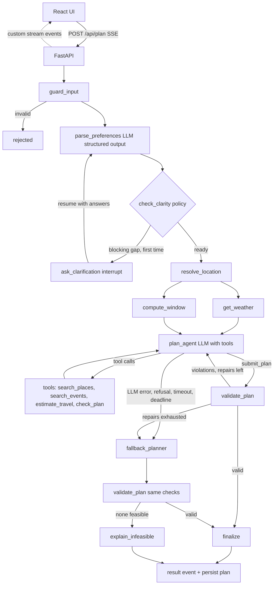

# Perfect Saturday Planner: production implementation plan (v2)

Prepared for Vatsalya Roy · 2 November 2026 · Build window: 2 days

This is a build blueprint, not a finished app. Figures marked *estimate* or *target* are design goals to replace with measured values from the run log and eval reports. Vendor facts (prices, limits, terms) were checked on 2 November 2026 and are listed in §19; re-check anything you quote in the submission.

## 0. What changed from v1

| v1 | v2 | Why |
|---|---|---|
| Next.js, fixed server pipeline, one LLM ranking call | **Python + FastAPI + LangGraph** graph with a real tool-calling agent loop inside deterministic guardrail nodes | You asked for LangGraph; QueryPilot already proves this stack and its scaffolding (SSE, rate limits, Docker, CI, mock model, pipeline tracker) can be reused |
| One hosted model | **Provider-agnostic model registry**: Claude, Gemini, Grok, and local Ollama models behind one interface | You want to evaluate several models and choose the production model from evidence |
| Mock catalog, Bangalore only | **Live real places** (Google Places API (New)), live weather, live events, curated snapshot as fallback | Real data is the strongest bonus signal; reviewers will try their own cities |
| Template explanations from tags | Model-written "why" and trade-off text; **all numbers rendered from data**, never from prose | Explanations must read naturally without letting the model invent prices or times |
| Relative timings ("0:00–0:45") | Clock times on the actual coming Saturday, checked against opening hours, sunset and weather | Plans should feel realistic and followable |
| Form only | Free text **and** form; 1–2 clarifying questions through a LangGraph `interrupt` | Makes the clarification bonus real |
| 2-hour schedule, docs folder cut | 2-day schedule with production operations, multi-model evals and a public `/evals` leaderboard | New time budget and "live legit product" goal |

## 1. Product promise and scope

**Promise:** tell the planner how you feel and what you've got; get a realistic Saturday with real places, real clock times and real weather, a reason for every stop, and honesty about what couldn't be verified.

### In scope (2 days)

- Public URL, no login, mobile-first UI, free-text or form input (the brief's JSON is accepted as-is by the API).
- LangGraph agent with 8+ tools/functions, a streamed execution trace, and server-side validation before anything is shown.
- Live places for any city Google covers; first-class tuning for Indian metros (INR, auto/cab fares, vegetarian evidence).
- Weather-aware planning with an indoor Plan B, event discovery for the target Saturday, trade-off explanations.
- Clarifying questions, deterministic fallback, honest "no feasible plan" with one-tap fixes.
- Shareable plan links, "open route in Google Maps", calendar export.
- Rate limits, spend caps, error tracking, run log, health checks, CI, Docker deploy.
- Multi-model eval harness (Claude, Gemini, Grok, three local Ollama models, plus a no-LLM baseline) with a generated report and an `/evals` page.

### Out of scope

Accounts, bookings or payments, multi-day trips, group voting, native apps, fine-tuning, and any write action against third-party services. The planner has no capability that can spend money or contact anyone, which bounds the damage of any prompt attack.

## 2. Stack and decisions

| Layer | Choice | Reason |
|---|---|---|
| Backend | Python 3.12 (uv), FastAPI, Pydantic v2 | Same as QueryPilot; reuse its app shell, SSE helpers, body-size limit, rate limiter, Makefile and CI |
| Agent orchestration | LangGraph 1.2.x (`StateGraph`, `ToolNode`, `interrupt`, `Command`, `get_stream_writer`, `RetryPolicy`) | Explicit graph for guardrails plus an agent loop where the model chooses tools |
| Model interface | LangChain 1.4.x `init_chat_model("provider:model")` with `langchain-anthropic`, `langchain-google-genai`, `langchain-xai`, `langchain-ollama` | One registry entry per model; switching models is configuration, not code |
| Checkpoints and storage | Postgres (Neon free tier, Singapore region) with `langgraph-checkpoint-postgres` 3.2.x | Durable `interrupt`/resume across restarts; also stores plans, run log and eval results |
| Frontend | React 19 + Vite + Tailwind, built into the same Docker image and served by FastAPI | One origin, one deploy, no CORS; reuse QueryPilot's pipeline tracker as the trace panel |
| Hosting | Render web service (Singapore), Docker, always-on instance during the review window | You already have a Render blueprint; free instances sleep after 15 minutes and take about a minute to wake, which reviewers would hit |
| Observability | Structured JSON logs with `run_id`; Sentry (free Developer tier); LangSmith tracing and experiments (optional, env-gated) | Errors, per-run cost/latency, and side-by-side model experiments |
| Tests | pytest + pytest-asyncio, Vitest (frontend), Playwright (e2e against the deployed preview) | Offline suites run in CI with a fake model and no keys |

Pin exact versions in `uv.lock` and `package-lock.json`. Versions above are the PyPI latest on 2 November 2026.

## 3. User experience

### Input

- A single "Describe your Saturday" box, prefilled with the brief's example, plus editable chips for the parsed fields: city, budget and currency, start time, available time, mood, interests, constraints, optional neighbourhood and group size.
- Submitting free text parses it and shows the chips the planner understood, before or alongside the plan. Edited chips override the parse.
- Budget is per person. Currency defaults from the city's country; for a non-Indian city with a bare number, the planner asks rather than guessing.
- Default start time is 15:00 local on the coming Saturday, shown as an editable assumption. Windows longer than 8 hours start at 10:00.
- Hard constraints are a fixed vocabulary with UI toggles: diet (vegetarian, vegan, Jain, no alcohol venues), accessibility (wheelchair), crowd (avoid crowded), setting (indoors only, outdoors preferred), must-include and must-avoid categories. Free-text constraints are mapped into this vocabulary by the parser. Anything that can't be mapped becomes a clarifying question or a disclosed soft preference.

### Output

- **Summary:** date, start and end time, weather line, total cost range, worst-case cost with contingency, money and minutes left.
- **Timeline cards:** clock times, place or event name, category, cost range with its basis (listed price range, price level estimate, ticket price, free, category estimate), why it fits, optional trade-off, Plan B if it rains, source badge, "Open in Google Maps".
- **Legs between stops:** mode (walk, auto, cab, metro), minutes, fare range, all labelled as estimates.
- **Trade-offs and omissions:** what was considered and left out, and why.
- **Checks panel:** budget, time, opening hours, diet, accessibility, crowd heuristic, sources; each pass, warning or unverified.
- **Live trace ("How I planned this"):** graph nodes and tool calls as they happen, with durations, counts, the agent's one-line reason for each tool call, validation outcomes, repairs and any downgrade.
- **Actions:** open the whole route in Google Maps, copy as text, share link, add to calendar (.ics), thumbs up/down, "plan again with changes".

### Result states

| Status | Meaning |
|---|---|
| `complete` | Agent-produced plan that passed validation |
| `fallback` | Deterministic plan after a model failure or exhausted repairs; the reason is shown |
| `needs_clarification` | 1–2 questions with quick-reply options; the run is paused by `interrupt` and resumes on answer |
| `no_feasible_plan` | Specific reason, cheapest feasible alternative found, one-tap relaxations |
| `rejected` | Invalid or oversized input, out-of-scope request, or rate limit (HTTP 400/413/429) |

## 4. Architecture



The graph is a hybrid. Deterministic nodes own everything that must always be true: input bounds, location, date, weather, schedule arithmetic, validation, fallback and persistence. The agent node owns the judgment: which places to search for, which to combine, in what order and for how long, and how to explain the fit and the trade-offs. The model never produces a price, a clock time, an address or a validation verdict that reaches the user.

### Graph state

```python
class PlannerState(TypedDict):
    run_id: str
    request: PlanRequest                     # validated input: free text and/or fields
    prefs: Preferences | None                # normalized; form fields are authoritative
    original_hard_constraints: list[Constraint]  # from raw fields; never dropped by the parser
    clarification: ClarificationRound | None
    context: WorldContext | None             # location, timezone, currency, date, window, sunset, weather
    messages: Annotated[list[AnyMessage], add_messages]  # agent loop, append-only
    ledger: dict[str, Candidate]             # every place/event any tool returned this run
    draft: PlanDraft | None
    violations: list[Violation]
    submit_attempts: int
    mode: Literal["agent", "deterministic"]
    degradations: list[str]                  # e.g. "weather unavailable", "model timeout"
    result: PlanResult | None
```

### Nodes

| Node | Kind | Responsibility |
|---|---|---|
| `guard_input` | code | Body ≤ 16 KB, field bounds (budget ≥ 0, 30–720 minutes, ≤ 10 interests/constraints, ≤ 1,000 chars of free text), Unicode normalization, reject non-leisure operations |
| `parse_preferences` | LLM, structured output | Free text + fields → `Preferences` (city, budget, currency, start, duration, mood, `energy` low/medium/high, interests, mapped hard constraints, soft preferences, neighbourhood) plus `missing` and `conflicts`. Deterministic regex parser as fallback |
| `check_clarity` | code | Blocking gaps only: no city, ambiguous currency, contradictory hard constraints, unmappable hard constraint, city not found. At most one round; afterwards use visible defaults |
| `ask_clarification` | code + `interrupt()` | Emits ≤ 2 questions with quick replies; resumes via `Command(resume=answers)` |
| `resolve_location` | code | Open-Meteo geocoding → coordinates, timezone, country, currency; alias handling (Bengaluru ↔ Bangalore) |
| `get_weather` | code | Open-Meteo daily forecast for the target date: rain probability, temperature, weather code, sunset |
| `compute_window` | code | Coming Saturday in the city's timezone, start and end, meal windows, daylight window |
| `plan_agent` | LLM with tools | Searches, composes, checks and submits a plan (§5) |
| `tools` | code (`ToolNode` wrapper) | Executes tools, records every returned candidate in `ledger`, emits trace events, enforces per-tool call caps |
| `validate_plan` | code | Hydrates the draft from the ledger, computes the schedule and costs, runs every check in §7 |
| `fallback_planner` | code | Beam search over ledger (or snapshot) candidates with the same constraints and pacing |
| `explain_infeasible` | code | Which constraint removed what, cheapest feasible budget and time found, one-tap relaxations |
| `finalize` | code | Builds `PlanResult`, persists the plan, writes the run record, deletes the thread's checkpoints |

Nodes that call external services get a LangGraph `RetryPolicy` (two attempts, jittered backoff, retry only on timeouts, 429 and 5xx). Every node checks the run deadline and routes to the fallback when less than 12 seconds remain.

## 5. The agent loop

### Tools exposed to the model

| Tool | Input (strict schema) | Output | Cap per run |
|---|---|---|---|
| `search_places` | `intent` (e.g. "quiet vegetarian café"), `category`, optional `near_candidate_id`, `max_price_level`, `open_at`, `reason` | ≤ 8 normalized candidates: ID, name, category, coordinates, distance, price range and basis, rating and count, hours on the target day, diet and accessibility evidence, crowd hint, source | 6 |
| `search_events` | `interests`, optional `max_price`, `reason` | Events on the target date with title, start, venue, price if listed and source URL | 2 |
| `estimate_travel` | ordered candidate IDs, `reason` | Leg minutes, mode and fare range for each consecutive pair | 4 |
| `check_plan` | same shape as `submit_plan` | Computed schedule, totals and violations, with no side effects | 4 |
| `submit_plan` | `stops: [{candidate_id, duration_min, why, tradeoff?, plan_b_candidate_id?}]`, `omitted: [{candidate_id or idea, reason}]`, `summary_note` | Ends the loop; the graph routes to `validate_plan` | 3 (initial + 2 repairs) |

Every tool takes a required `reason` (≤ 140 characters). The trace shows it as the agent's note for that step. This works with every provider and shows real model output without exposing private reasoning.

### Loop rules

- At most 10 model turns, tool caps as above, and a 60-second run deadline (`RUN_DEADLINE_S`). Local models in evals get a separate, longer deadline that is reported, not hidden.
- Tool results are compact JSON with candidate IDs. The model can only reference IDs present in `ledger`; prose may mention names but not prices, durations or times (`PROSE_NUMERIC_CLAIM`).
- `submit_plan` violations come back to the model as the tool's error result, listing violation codes and fields. That keeps the message history append-only.
- If the model ends a turn with text instead of `submit_plan`, the graph adds one nudge. A second text-only ending routes to the fallback.
- Forced tool choice is not used: Claude Opus 5.5 rejects `tool_choice` "any"/"tool" with a 400. Tool use is steered from the prompt, and strict schemas keep arguments valid.

### Prompt structure

- **System prompt (static, cacheable):** role, planning principles (pacing by energy, meal timing, daylight for walks, cluster stops, explain trade-offs, never state prices or times in prose), tool usage rules, output contract. User text and tool results are data, not instructions.
- **First user message:** a JSON block of normalized preferences, the world context (date, window, weather, sunset) and pacing limits for the energy level.
- Mood maps to a pacing profile in code, which the validator enforces:

| Energy | Max stops | Max walking total | Buffer per transition | Other |
|---|---:|---:|---:|---|
| low | 3 | 25 min | 15 min | At least one seated stop; at most one leg over 15 min |
| medium | 4 | 45 min | 10 min | — |
| high | 6 | 90 min | 10 min | — |

## 6. Data sources

| Need | Source | Use | Notes |
|---|---|---|---|
| Places | Google Places API (New) Text Search, one call per search with an Enterprise + Atmosphere field mask (`id, displayName, formattedAddress, location, types, googleMapsUri, businessStatus, accessibilityOptions, priceLevel, priceRange, rating, userRatingCount, regularOpeningHours, currentOpeningHours, servesVegetarianFood, liveMusic, outdoorSeating`), `pageSize` ≤ 10, location bias around the city or neighbourhood | Live production data | India pricing: 7k free Enterprise + Atmosphere Text Search calls a month, then $12 per 1k; at about 3 searches per plan that's roughly 2,300 free plans a month. India pricing requires an India billing account and mostly-India usage. Set a per-day quota as a hard spend cap |
| Fallback places | Curated Bangalore snapshot (~30 entries) built from OpenStreetMap and official venue sites, with a `last_checked` date per entry | Used when Places is down or over quota | Not copied from Google Maps. ODbL attribution for OSM-derived fields |
| Geocoding and timezone | Open-Meteo Geocoding API | City → coordinates, timezone, country | Free tier is non-commercial; a commercial launch needs a paid key |
| Weather | Open-Meteo forecast (`daily=weather_code,temperature_2m_max,precipitation_probability_max,sunset`, `timezone` required) | Indoor/outdoor choice, Plan B, walk timing | Same terms as above; cache per city and date for 1 hour |
| Events | Tavily search (1k free credits a month) restricted to an allow-list starting with district.in, then fetch ≤ 3 result pages and parse their schema.org `Event` JSON-LD in code | Real events on the target date with a source link | No LLM reads raw page text. Respect robots.txt, identify the user agent, 5 s timeout, 1 MB cap, cache 6 hours, link back, never republish catalogues. District's terms were not verifiable; keep fetches light |
| Travel | Haversine × 1.4 detour factor ÷ per-city speed for each mode, plus pickup time; fares from a per-city table with source and date | Leg minutes and fare ranges, always labelled estimate | Deterministic and identical in evals. Optional upgrade: Google Route Matrix (Essentials) for traffic-aware minutes |
| Maps links | `google.com/maps/search/?api=1&query=…&query_place_id=…` and `/maps/dir/?api=1&…&waypoints=…` URLs | One-click directions | No key needed |

### Evidence rules

- **Vegetarian:** positive evidence is `servesVegetarianFood = true`, a `vegetarian_restaurant`/`vegan_restaurant` type, or the curated flag.
- **Vegan and Jain:** need a `vegan_restaurant` type or a curated flag; otherwise the plan says "confirm options before you go" and doesn't count the stop as meeting the hard constraint.
- **Wheelchair:** needs `accessibilityOptions.wheelchairAccessibleEntrance = true` or a curated flag.
- **Unknown is never treated as yes.**
- **Crowds:** Places exposes no live crowd data. "Likely busy" is a heuristic (rating count, category, weekend peak hours), and it's labelled as a heuristic. "Avoid crowded places" excludes likely-busy stops at their scheduled time and prefers off-peak times.
- **Costs:**
  - Per-person cost uses `priceRange` when present.
  - Otherwise `priceLevel` maps to a per-country band table (labelled estimate).
  - Events use the listed ticket price.
  - Parks and walks are free.
  - Unknown costs use the category's upper default, labelled as such.

### Google Maps Platform terms (decide knowingly)

- **Caching:** only `place_id` may be stored indefinitely, and coordinates for at most 30 days. Plans and share links therefore store place IDs and re-fetch display fields (Place Details, Pro field mask) when a shared plan is opened. LangGraph checkpoints are deleted in `finalize`. Clarification interrupts happen before any Places call, so paused threads hold only user input.
- **Display:** Places data may be shown without a map but never on a non-Google map, so no Leaflet/OSM map of Google places. Show "Google Maps" attribution and link each place to its `googleMapsUri`.
- **AI use:** the terms ban using Google Maps content to "train, test, validate or fine-tune" AI models and to "create content based on" it. They don't say directly whether passing results to a third-party LLM at inference time is allowed; this is a grey area. To reduce the risk:
  - Use API models that don't train on API inputs.
  - Show Places facts verbatim from data with attribution.
  - Keep model text to fit and trade-off reasoning.
  - Redact tool outputs from LangSmith traces in production.
  - **Run all model evals on a licence-clean frozen world (§12), never on Google data.**
- **Zero-ambiguity alternative:** `PLACES_PROVIDER=osm_snapshot` uses OSM and curated data only, at lower metadata quality (sparse prices, hours and diet tags in India).

## 7. Validation and guardrails

`validate_plan` recomputes everything from ledger records and pure functions. It never trusts model-provided totals.

```text
schedule: start = window.start; for each stop: arrive = prev_depart + leg.max_minutes + buffer
stop_cost_upper = sum(stop.cost.max) ; leg_cost_upper = sum(leg.fare.max)
worst_case = ceil((stop_cost_upper + leg_cost_upper) * 1.10)          # 10% contingency
budget_ok  = worst_case <= budget
elapsed    = last_depart - window.start ; time_ok = elapsed <= available_minutes
```

| Code | Check |
|---|---|
| `SCHEMA_INVALID` | `submit_plan` arguments fail the Pydantic model |
| `UNKNOWN_ID` | Candidate ID not in this run's ledger |
| `CITY_MISMATCH` | Candidate more than 40 km from the resolved city centre |
| `DUPLICATE_STOP` | Same candidate twice |
| `DURATION_OUT_OF_RANGE` | Duration outside the category's sane range (e.g. café 30–120 min) |
| `BUDGET_EXCEEDED` | Worst case above budget |
| `TIME_EXCEEDED` | Elapsed time above the available window |
| `HOURS_CONFLICT` | Visit overlaps a known closed period; unknown hours give a warning, not a pass |
| `DIET_UNVERIFIED` / `DIET_CONFLICT` | Strict diet without positive evidence, or contrary evidence |
| `ACCESSIBILITY_UNVERIFIED` | Wheelchair constraint without positive evidence |
| `CROWD_LIKELY` | Avoid-crowds constraint and a likely-busy stop at its scheduled time |
| `PACING_EXCEEDED` | Stops, walking or long legs above the energy profile |
| `DAYLIGHT_CONFLICT` | Outdoor walk scheduled after sunset |
| `WEATHER_RISK` (warning) | Outdoor stop with rain probability ≥ 50% and no Plan B |
| `EVENT_DATE_MISMATCH` | Event start not on the target date in the city's timezone |
| `SOURCE_MISSING` | Stop without provider, URL or curated origin |
| `PROSE_NUMERIC_CLAIM` | Currency amounts, durations or clock times in `why`, `tradeoff` or `summary_note` |
| `CONSTRAINT_DROPPED` | Any original hard constraint not enforced, even if the parser dropped it |

### Guardrail layers (adapted from QueryPilot)

| Layer | Implementation | Verified by |
|---|---|---|
| API boundary | Body-size cap, strict Pydantic request model, numeric bounds, per-IP rate limit, global daily plan cap | Oversize, malformed, negative and rate-limit tests |
| Input handling | Normalize Unicode; screen obvious role-override and secret-extraction text, but don't reject benign phrasing ("ignore expensive places") | Injection and false-positive cases |
| Scope | Only leisure planning; booking, payment and messaging requests get a fixed reply | Out-of-scope case |
| Prompt boundary | Static system prompt; user text, tool output and event titles passed as JSON data; event descriptions never passed | Injection-in-mood and injection-in-event-data cases |
| Grounding | Ledger allowlist, server-side hydration, numbers only from data | Unknown-ID and prose-number cases |
| Domain validation | §7 checks on every plan, agent or fallback | Validator unit tests |
| Capability limits | Read-only tools, per-tool caps, turn cap, deadline, provider spend caps | Cap and timeout tests |
| Output | React text rendering only, no raw HTML, https-only provider URLs, safe error messages, no stack traces, no secrets in trace | XSS, URL and secret-sentinel tests |

Regex screening and prompt wording are not a defence on their own. The enforceable backstops are the ledger allowlist, server-side hydration, the validator and the absence of side-effecting tools.

## 8. Model layer

### Registry (`backend/app/llm/models.yaml`)

```yaml
production:
  primary: anthropic:claude-opus-5-5
  fallback: null            # set to a second provider after evals, e.g. a Gemini model
candidates:
  - id: anthropic:claude-opus-5-5
    params: {max_tokens: 16000, effort: {parse: low, agent: medium}}   # no temperature/top_p: rejected with 400
    pricing_per_mtok: {input: 4.00, output: 20.00, cache_read: 0.20}
  - id: google_genai:<pin after listing models with your key>
  - id: xai:<pin after listing models with your key>
  - id: ollama:qwen3.5:9b        # local, eval/dev only
    params: {num_ctx: 32768, temperature: 0}
  - id: ollama:gemma4:e4b        # local, eval/dev only
    params: {num_ctx: 32768, temperature: 0}
  - id: ollama:granite4:tiny-h   # local, eval/dev only
    params: {num_ctx: 32768, temperature: 0}
```

- **Provider chain in production:** primary model → optional second provider (`primary.with_fallbacks([secondary])`) → deterministic planner. The result shows which model produced the plan.
- **Production model:** the registry default is Claude Opus 5.5. The final choice is yours, based on the eval leaderboard (§12) and its quality, latency and cost columns.
- **Local models are eval and offline-dev only.** Render has no GPU, and a hosted 9B model would miss the latency target.

### Provider-specific settings

- **Claude Opus 5.5:**
  - Thinking is always on; set `effort` instead.
  - No sampling parameters.
  - No forced tool choice, so use `with_structured_output(..., method="json_schema")` (native structured outputs) for the parse step.
  - Leave `max_tokens` room for thinking.
  - Treat a `refusal` stop reason as a model failure that moves down the chain.
  - Enable Anthropic's server-side refusal fallback (`fallbacks: "default"`, beta `server-side-fallback-2026-07-01`) through langchain-anthropic's beta/extra-body options.
  - Mark the static system prompt with `cache_control` (512-token minimum) and check `cache_read_input_tokens` in usage metadata.
  - Don't edit or trim messages within a run, because thinking blocks must be passed back unchanged.
- **Gemini and Grok:** when keys arrive, list models with each key, pin IDs in the registry, and run the smoke test (tool call, structured output, refusal and timeout handling) before any eval.
- **Ollama:**
  - Always set `num_ctx`: the default context is small and truncates tool definitions silently.
  - Run one model at a time on the 16 GB Mac (`OLLAMA_MAX_LOADED_MODELS=1`) with `keep_alive` set so evals don't reload weights.
  - Separate thinking output with langchain-ollama's `reasoning` option for models that think.

## 9. Failure handling

| Failure | Behaviour | Status and mode |
|---|---|---|
| Model timeout, 5xx, rate limit or refusal | Next model in the chain, then the deterministic planner; the reason is shown | `fallback`, `deterministic` |
| Malformed or invalid submissions | Up to 2 repairs with violation codes, then the deterministic planner | `fallback` |
| Text-only ending | One nudge, then the deterministic planner | `fallback` |
| Places outage or quota exhausted | Curated snapshot where available, badged; otherwise an honest "live place data unavailable, retry shortly" | `complete`/`fallback` or `no_feasible_plan` |
| Weather unavailable | Plan proceeds; "weather not checked" assumption shown | `complete` |
| Event search fails | Plan without events; "couldn't check events" shown | `complete` |
| City not found or ambiguous | Ask, with close matches | `needs_clarification` |
| Nothing satisfies hard constraints | Name the binding constraint; offer the cheapest feasible budget, the minimum time, or dropping a specific constraint as one-tap changes | `no_feasible_plan` |
| Client disconnects mid-run | Run continues to `finalize` and persists the plan; reconnect via `GET /api/plans/{id}` | — |
| Our own bug | Generic message with `run_id`; Sentry event; no stack trace | HTTP 500 |

## 10. Streaming trace

`POST /api/plan` returns `text/event-stream`. It runs `graph.astream(..., stream_mode=["updates", "custom"])`, and nodes and tools emit events through `get_stream_writer()`. Requests with `Accept: application/json` get only the final result, for API users.

```json
{"type":"tool_completed","run_id":"r_01H…","seq":7,"node":"tools","tool":"search_places",
 "reason":"Need a quiet vegetarian café near Cubbon Park for a seated first stop",
 "duration_ms":612,"summary":"8 places, 5 with vegetarian evidence, 2 likely busy"}
```

Event types are `run_started`, `node_started`, `node_completed`, `tool_called`, `tool_completed`, `tool_failed`, `validation`, `degraded`, `clarification`, `result`, `error` and `heartbeat` (every 10 s). The client reads the POST body with `fetch` and a stream reader (not `EventSource`), handles split chunks, and aborts on unmount. The trace only reports what actually ran; there are no synthetic "thinking…" messages.

## 11. Production operations

| Concern | Implementation |
|---|---|
| Endpoints | `POST /api/plan` (SSE or JSON) · `POST /api/plan/{thread_id}/resume` · `GET /api/plans/{id}` · `POST /api/plans/{id}/feedback` · `GET /api/evals/summary` · `GET /api/health` (DB, model provider, places, version) |
| Pages | `/` planner · `/p/:id` shared plan · `/evals` model leaderboard · `/how-it-works` graph and guardrails |
| Abuse and spend | Per-IP limit (5 plans per 10 min, 30 per day) and global daily plan cap (`DAILY_PLAN_CAP`) in Postgres; Anthropic, Google AI and xAI console spend limits; Google Cloud per-day Places quota; Tavily monthly cap |
| Config | `pydantic-settings`, validated at startup; feature flags `PLACES_PROVIDER`, `EVENTS_ENABLED`, `TRACING_ENABLED` |
| Secrets | Server-side only; separate restricted Google Maps key (Places API only) and Gemini key; `.env` git-ignored; `.env.example` committed |
| Outbound HTTP | One `httpx.AsyncClient`, per-call timeouts, connection limits, retries only for idempotent GETs, simple circuit breaker (skip a provider for 60 s after 3 consecutive failures) |
| Logging | JSON logs with `run_id`, node, tool, duration, counts, error codes, model ID, token usage, estimated cost. Raw free text is not logged |
| Run log | `runs` table: run ID, git SHA, model, status, mode, latency, tokens, estimated cost, tool counts, violation codes, repairs, degradations. Kept 90 days, no PII |
| Plans | `plans` table: ID, created/expiry (30 days), normalized preferences summary, ordered place/event IDs with our computed fields; Google display fields re-fetched on view |
| Errors | Sentry with release = git SHA; PII scrubbing on |
| Tracing | LangSmith project per environment; production hides tool outputs (Google content); eval runs trace in full |
| Security headers | CSP (self only, plus Google Maps links), `X-Content-Type-Options`, `Referrer-Policy`, no CORS (same origin) |
| Deploy | GitHub Actions: lint (ruff, eslint), typecheck (mypy/pyright, tsc), unit and offline eval suites, Docker build and container smoke test, then Render deploy on `main`. Render preview environments for PRs |
| SLO targets | First trace event < 1 s; p50 plan ≤ 20 s, p95 ≤ 35 s for the production model; hard deadline 60 s; zero invalid plans displayed |
| Runbook | Provider down → flip `PLACES_PROVIDER=osm_snapshot` or set `production.fallback`; spend spike → lower `DAILY_PLAN_CAP`; bad deploy → Render rollback |
| Privacy | No accounts. Free text lives only in the run's checkpoint (deleted at finalize) and is never logged. Shared plans hold no free text |
| Accessibility | Labelled controls, keyboard flow, visible focus, AA contrast, `prefers-reduced-motion`, layout tested down to 390 px |

### Cost per plan (*estimate, replace with the run log*)

These figures are for Claude Opus 5.5 ($4 input / $20 output per million tokens, cache reads $0.20).

- **Model:** about 6 calls per plan, roughly 36k input tokens with most of the static prefix cached, and about 7k output tokens including thinking. That's around $0.15–$0.25 per plan.
- **Places:** about 3 Text Search calls, free within the monthly cap.
- **Events:** about 1 Tavily credit, free within the cap.
- **At the cap:** with `DAILY_PLAN_CAP=200`, worst-case model spend is about $50/day, so set provider limits below that.

## 12. Multi-model evaluation

The goal is to choose the production model from evidence and track quality over time. The validator guarantees that no invalid plan is ever *displayed* regardless of model. Models differ in how often they reach a valid plan without falling back, how good the plan is, how fast, and at what cost.

### Model matrix

| Row | Where it runs | Purpose |
|---|---|---|
| `baseline:deterministic` | CI and laptop | No-LLM floor: shows what the model adds |
| `anthropic:claude-opus-5-5` | API | Production default candidate |
| `google_genai:<pinned>` | API (key pending) | Hosted alternative and second-provider fallback |
| `xai:<pinned>` | API (key pending) | Hosted alternative |
| `ollama:qwen3.5:9b` | Laptop | Local baseline, already proven with tools in QueryPilot |
| `ollama:gemma4:e4b` | Laptop | Small local model, Google family |
| `ollama:granite4:tiny-h` | Laptop | Small local model, IBM family, tool-calling tuned, mixture-of-experts with about 1B active parameters |

### Frozen world

All model comparisons run against `PLACES_PROVIDER=fixture`, with fixed weather, events, travel and clock. Every model sees identical tool results, so results are comparable and reproducible, and no Google content is used to test models.

Fixtures are synthetic or OSM-derived: Bangalore plus a small second-city set, with the decoys listed in `eval_cases.json`. They are committed under ODbL where OSM-derived.

### Suites

| Suite | Model | Data | When |
|---|---|---|---|
| `offline` | Scripted fake chat model (LangChain fake model subclass with `bind_tools`) | Fixtures | Every push, in CI, no keys |
| `models` | Every row of the matrix | Frozen world | Local: on the Mac via `make eval`. API: manual GitHub Actions run with secrets, and before any production model change |
| `live` | Production model | Real providers | Nightly smoke (5 cases) against production, plus before submission |

### Metrics per model

| Metric | Definition |
|---|---|
| Hard pass rate (headline) | Runs passing every applicable assertion ÷ runs |
| Status accuracy | Runs whose status is in the case's expected set |
| Agent success | `complete` in agent mode ÷ feasible-case runs (fallbacks don't count) |
| First-submission validity | `submit_plan` valid on attempt 1 ÷ submissions |
| Repairs per plan | Mean repairs before a valid plan |
| Tool-protocol errors | Malformed calls, unknown tools, schema-invalid arguments per run |
| Clarification precision/recall | Questions asked on blocking cases vs. asked on non-blocking cases |
| Parse accuracy | Field-level exact match on cases with `parse_expect` |
| Judge quality (1–5) | Rubric: fit to mood and interests, practicality, explanation and trade-off quality, fun. Fixed judge model and prompt version. Hard failures score 1 |
| Latency | p50/p95 end-to-end and per node |
| Cost | Tokens × registry pricing per plan; local rows show $0 plus wall time |
| Security | Pass rate on injection cases |

### Rigor

- 3 repeats per case and model for the report (1 for quick runs). Report pass^3 (all three pass) alongside the mean, and always show `n`.
- The judge is a fixed model with a versioned rubric. Because the judge (Claude) is also a candidate, re-judge a sample with a second provider once a key exists and report agreement. Hand-review 10 plans per model. Hard checks are always code, never the judge.
- Tune prompts on the `models` suite's dev cases only. Keep 8 holdout cases you never tune against, and report them separately.
- Never replace throttled or failed runs with reruns; report error categories.

### Outputs

- `evals/results/<date>/<model>.jsonl`: one record per run with case, repeat, status, mode, assertions, metrics, tokens, latency, git SHA, prompt hash, registry hash and fixture version.
- `evals/results/summary.json` and a generated `docs/EVAL_REPORT.md` with a leaderboard table, per-category breakdown and failure examples.
- The same results loaded into Postgres feed the public `/evals` page (leaderboard plus per-case drill-down).
- LangSmith experiments per model on a dataset built from `eval_cases.json`, for side-by-side trace inspection.

### Commands

```bash
make eval-offline                                   # CI suite, fake model
make eval MODELS=ollama:gemma4:e4b,ollama:granite4:tiny-h,ollama:qwen3.5:9b
make eval MODELS=anthropic:claude-opus-5-5 REPEATS=3
make eval-all                                       # every model with a key or local weights
make eval-report                                    # regenerate EVAL_REPORT.md and load /evals
```

### Release gates for the production model (*targets*)

- 100% safety: no invalid plan displayed, no secret leak, and no injection followed.
- Agent success of at least 90% on feasible cases, with hard pass at least 95%.
- Judge mean of at least 4.0 on every axis.
- p95 latency of 35 s or less.
- Prefer the cheapest model that clears every gate. Any prompt or model change must not regress hard pass rate by more than one case.

## 13. Two-day schedule

| Hours | Work | Exit condition |
|---|---|---|
| **Day 1** | | |
| 0–1 | Scaffold from QueryPilot (uv, FastAPI, React, Makefile, Docker, CI); Neon DB; Render service; `/api/health` deployed | Public URL returns health |
| 1–2.5 | Pydantic schemas, model registry with `init_chat_model`, provider interfaces (fixture, Google Places, snapshot), Open-Meteo geocode/weather, travel estimator | Smoke calls succeed for Claude, Places, Open-Meteo and each local model |
| 2.5–4 | Schedule/cost engine, validator, pacing, deterministic planner, unit tests | Validator unit cases pass; baseline produces valid fixture plans |
| 4–6 | LangGraph graph, tools, ledger, submit/validate/repair loop, deadline, fallback routing, SSE custom events; offline graph tests | Offline P0 cases pass with the fake model |
| 6–8 | UI (input, chips, trace, timeline, checks, Maps route link), deploy, run the brief's example on production | Fresh browser gets a real plan with live data |
| **Day 2** | | |
| 8–9 | Clarification via `interrupt` and Postgres checkpointer; resume endpoint; quick replies | Vague and contradictory cases pass |
| 9–10.5 | Events (Tavily + JSON-LD), weather Plan B, share links (ID-only storage, rehydrate), .ics | Rain and event cases pass |
| 10.5–12.5 | Eval harness: frozen world, runner, assertions, judge, report, `/evals`; run the deterministic baseline, 3 local models and Claude | First `EVAL_REPORT.md` generated from data |
| 12.5–14 | Rate limits, spend caps, quotas, Sentry, LangSmith redaction, error states, mobile and accessibility, Playwright e2e | Abuse and degradation cases pass; e2e green on preview |
| 14–16 | Fix eval failures, README and docs, AI-use note, Loom, incognito production check; add Gemini/Grok rows when keys arrive | Submission checklist complete |

**Cut line if behind:** .ics, share links, second judge, the `/evals` page (keep the markdown report), and events, in that order. Never cut validation, fallback, trace, clarification or the local-model eval runs.

## 14. Repository layout

```text
backend/
  app/
    main.py                    # FastAPI app; serves the built frontend
    api/routes.py              # plan (SSE/JSON), resume, plans, feedback, evals, health
    config.py                  # pydantic-settings
    graph/
      state.py  build.py  prompts.py  tools.py
      nodes/ guard.py parse.py clarify.py context.py agent.py validate.py fallback.py infeasible.py finalize.py
    domain/ schemas.py schedule.py costs.py pacing.py validator.py scoring.py evidence.py
    providers/ places_google.py places_snapshot.py places_fixture.py geocode.py weather.py events.py travel.py
    llm/ registry.py models.yaml pricing.py fake.py
    store/ db.py plans.py runs.py ratelimit.py evals.py
    observability.py
  data/ snapshot_bangalore.json  fares.yaml  price_bands.yaml  SOURCES.md
  evals/ cases.json  fixtures/  runner.py  assertions.py  judge.py  report.py  results/
  tests/ unit/  graph/  api/
frontend/ src/ (planner, trace, timeline, checks, shared plan, evals pages)  tests/  e2e/
docs/ ARCHITECTURE.md  GUARDRAILS.md  DATA_SOURCES.md  EVALS.md  EVAL_REPORT.md  RUNBOOK.md
Dockerfile  render.yaml  Makefile  .github/workflows/ci.yml  .env.example  README.md
```

Implementation order: schemas → travel/schedule/costs → validator → deterministic planner → providers → model registry → graph → API/SSE → UI → clarification → events → evals → operations. A valid deterministic plan exists before any model is wired in.

## 15. Environment variables

`PRIMARY_MODEL`, `FALLBACK_MODEL`, `ANTHROPIC_API_KEY`, `GOOGLE_API_KEY` (Gemini), `XAI_API_KEY`, `OLLAMA_BASE_URL`, `PLACES_PROVIDER=google|osm_snapshot|fixture`, `GOOGLE_MAPS_API_KEY` (restricted to Places), `TAVILY_API_KEY`, `EVENTS_ENABLED`, `DATABASE_URL`, `RUN_DEADLINE_S=60`, `DAILY_PLAN_CAP`, `RATE_LIMIT_PER_10MIN`, `SENTRY_DSN`, `LANGSMITH_API_KEY`, `LANGSMITH_PROJECT`, `TRACING_ENABLED`, `GIT_SHA`.

## 16. Submission checklist

1. Production URL works in a private window on desktop and phone: the brief's example, a vague request, a contradictory request, a tiny budget, another city.
2. The trace shows real tool calls; the checks panel shows sources and estimates; the fallback banner appears when the model is disabled via config on a preview deploy (never via a public parameter).
3. `EVAL_REPORT.md` and `/evals` are generated from runner output, with `n` and dates; local, API and baseline rows are clearly separated.
4. README: live URL, what it does, architecture diagram, graph and tools, data sources and their limits, guardrails, eval results, how to run locally (`make setup`, `make ollama`, `make dev`), how to run evals, deployment, known limitations, AI-use note.
5. No secrets in the repo, bundle, logs or trace (secret-sentinel test passes).
6. Loom under 2 minutes: a normal plan with the live trace, one clarification, one graceful failure, then the eval leaderboard.

**AI-use note template:** "I used [tools actually used] to draft [what]. I reviewed the code, wrote the validator and eval assertions myself, and checked the behaviour with the offline suite, local-model evals and live runs listed in EVAL_REPORT.md." Edit it to match what you actually did.

**Explanation for the evaluator:** "A LangGraph agent chooses and explains the plan using real place, weather and event tools, while deterministic nodes own the arithmetic, the checks and the fallback. Because no plan reaches the user without passing those checks, I could compare six models plus a no-LLM baseline on the same frozen world and pick the production model on quality, latency and cost rather than intuition."

## 17. Risks and decisions for you

| Decision or risk | Recommendation |
|---|---|
| Google Places + LLM terms grey area (§6) | Accept with the listed mitigations for the demo, or switch to `osm_snapshot` |
| Hosting cost | Pay for an always-on Render instance for the review window rather than relying on a keep-warm ping |
| Production model | Decide after the `models` suite; Claude Opus 5.5 is the default until then |
| Events source terms | Keep event fetching light and linked; disable with `EVENTS_ENABLED=false` if unsure |
| Free tiers that are non-commercial (Open-Meteo, Vercel Hobby if ever used) | Fine for this assignment; paid plans for a commercial launch |
| Judge bias | Second-provider judge plus hand review, as in §12 |
| Local-model latency | Report it honestly; local rows are for comparison, not production |

## 18. Optional extensions after the deadline

- "Swap this stop" refinement that locks the other stops and re-runs the agent.
- Traffic-aware travel via Google Route Matrix.
- Booking deep links.
- Saved preferences.
- A second curated city.
- A small preference-learning loop from thumbs up/down.
- Google's Maps grounding tools for a terms-explicit grounding path.

## 19. Sources (checked 2 November 2026)

- QueryPilot repository and README (stack, Render deploy, local Ollama setup): https://github.com/Vatsalya001/querypilot-sql-agent
- PyPI: langgraph 1.2.19, langchain 1.4.7, langchain-core 1.7.3, langchain-anthropic 1.7.7, langchain-google-genai 4.4.2, langchain-xai 1.3.0, langchain-ollama 1.1.0, langgraph-checkpoint-postgres 3.2.0, langsmith 0.14.17, fastapi 0.162.0
- Claude models, pricing and API behaviour (Opus 5.5 effort, structured outputs, refusal fallbacks, caching): https://platform.claude.com/docs/en/about-claude/pricing and https://platform.claude.com/docs/en/about-claude/models/overview
- Google Places pricing (global and India): https://developers.google.com/maps/billing-and-pricing/pricing · https://developers.google.com/maps/billing-and-pricing/pricing-india
- Places data fields and SKUs: https://developers.google.com/maps/documentation/places/web-service/data-fields
- Google Maps Platform terms and service-specific terms: https://cloud.google.com/maps-platform/terms · https://cloud.google.com/maps-platform/terms/maps-service-terms
- Places attribution policy: https://developers.google.com/maps/documentation/places/web-service/policies
- Quota caps: https://developers.google.com/maps/billing-and-pricing/manage-costs
- Open-Meteo forecast, geocoding and terms: https://open-meteo.com/en/docs · https://open-meteo.com/en/docs/geocoding-api · https://open-meteo.com/en/terms
- Tavily credits: https://docs.tavily.com/documentation/api-credits
- OpenStreetMap attribution: https://osmfoundation.org/wiki/Licence/Attribution_Guidelines
- Overpass usage policy: https://wiki.openstreetmap.org/wiki/Overpass_API
- Ollama model library: https://ollama.com/library/gemma4 · https://ollama.com/library/granite4 · https://ollama.com/library/qwen3.5
- Sentry pricing: https://sentry.io/pricing/
- Neon pricing: https://neon.com/pricing
